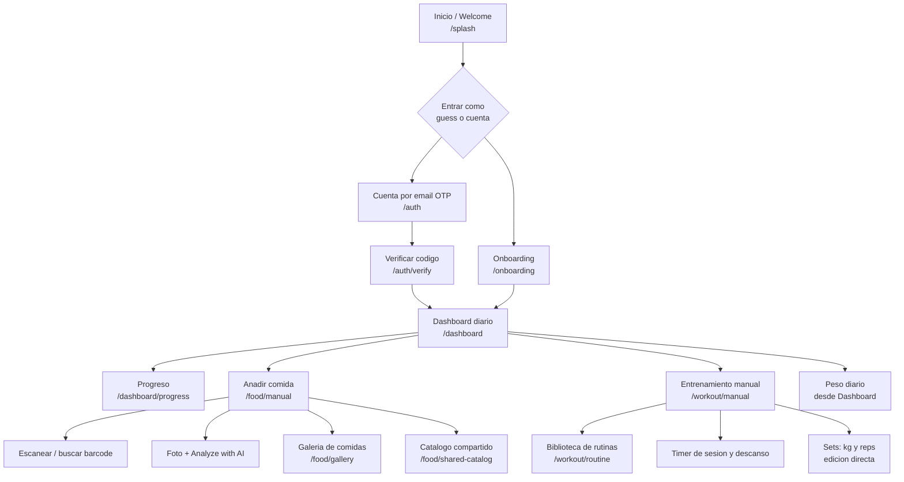
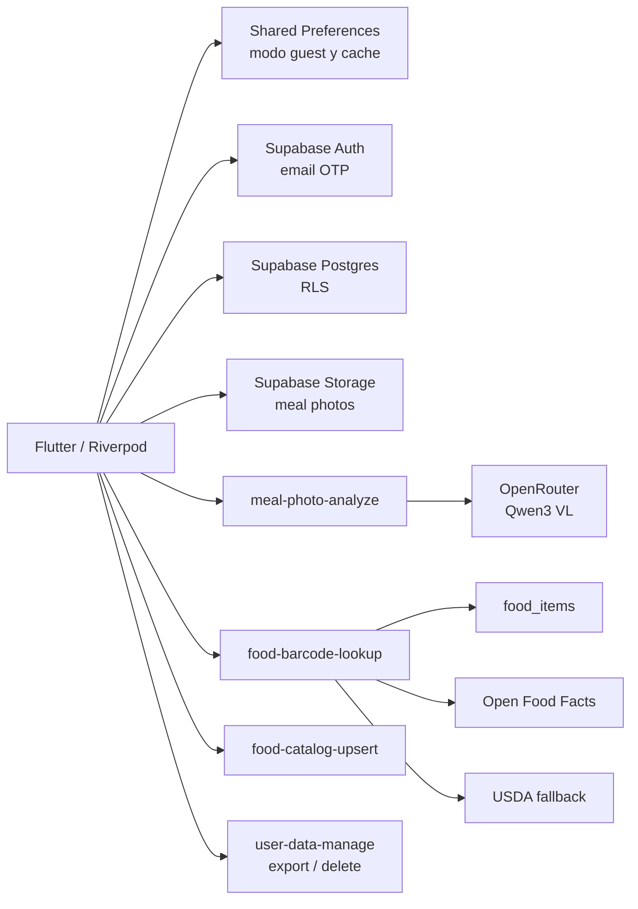
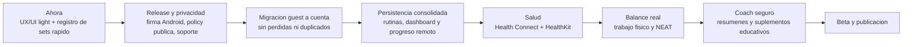

# Myfit: Mapa Visual y Roadmap

Actualizado: 2026-10-12.

Este documento muestra las pantallas navegables, las funciones disponibles y el orden de trabajo. Es la referencia visual actual; el detalle tecnico permanece en `docs/handoff/current_status.md`.

Para una vista de árbol genealógico de todas las funciones, abrir `docs/product/function_family_tree.md`.

## Leyenda

- `[LISTO]`: existe y fue validado en Android real o en pruebas automatizadas.
- `[EN CURSO]`: existe, pero requiere consolidacion, QA adicional o pulido.
- `[SIGUIENTE]`: es el proximo bloque de producto.
- `[FUTURO]`: no forma parte del trabajo inmediato.

## Paleta Actual

- 60%: blanco y gris cálido (`#F7F7F5`, `#FFFFFF`, `#F0F0ED`) para fondo y superficies.
- 30%: carbón (`#202124`) para texto, iconos y estructura visual.
- 10%: naranja energético (`#E6511E`) para CTAs y acciones principales.
- Estados: verde (`#2E7D32`) para éxito, rojo (`#C62828`) para error y naranja ámbar (`#F57C00`) para avisos.

## Mapa De Navegacion

## Funciones Disponibles Ahora

| Area | Ruta o acceso | Funciones | Estado |
|---|---|---|---|
| Welcome | `/splash` | Idioma EN/ESP, entrar como guest, entrar con cuenta, abrir app con sesion existente. | LISTO |
| Perfil energético | `/onboarding`, `/profile` | Peso, altura, fecha de nacimiento, sexo opcional, objetivo y actividad diaria en cuatro niveles. Se edita tocando el gasto diario estimado del dashboard. | LISTO |
| Cuenta | `/auth`, `/auth/verify` | Email OTP, sesion persistente, sign out, exportar datos y borrar datos remotos. | LISTO |
| Dashboard | `/dashboard` | Resumen diario, macros, objetivo, comida, peso, actividad, gasto diario estimado y estado de balance. | EN CURSO: integrar mejor los tiempos y datos remotos en analitica. |
| Peso | Dashboard | Registro e historial de peso diario, con persistencia hibrida. | LISTO |
| Comida manual | `/food/manual` | Nombre, tipo, kcal, proteina, carbs, grasas, azucar, fibra, editar y borrar. | LISTO |
| Barcode | Dentro de comida y catalogo | Camara o codigo manual; cache Supabase, Open Food Facts y fallback USDA. | LISTO |
| Foto de comida | Dentro de comida | Camara/galeria, IA, confianza, ingredientes y peso editables, recalculo de macros. | LISTO |
| Galeria | `/food/gallery` | Ver comidas con foto, macros, confianza, editar y borrar. | LISTO |
| Catalogo compartido | `/food/shared-catalog` | Alta de productos, etiqueta/OCR/IA, barcode y puntuacion nutricional. | EN CURSO: falta QA amplia. |
| Workout | `/workout/manual` | Sesiones, ejercicios, grupos musculares, sets multiples, reps, peso, RPE, notas, editar/borrar y recientes. | LISTO |
| Registro rapido de sets | Dentro de workout | Sets siempre visibles; editar kg y reps en linea, sin abrir modal. Acciones secundarias en menu. | EN CURSO: primera iteracion UX light. |
| Timers | Dentro de workout | Timer de sesion, descanso, sonido, vibracion y tiempos total/activo/descanso. | LISTO |
| Rutinas | `/workout/routine` | Rutinas semanales, rutina activa, bloques normales/superserie/triserie y carga por dia. | LISTO local-first |
| Progreso | `/dashboard/progress` | Peso, calorias, fuerza, volumen, peso maximo y 1RM educativo. | EN CURSO: completar consumo de datos remotos. |

## Datos Y Servicios

## Roadmap Por Orden

## Enfoque UX De Workout

El criterio para la pantalla de entrenamiento es completar un set habitual en menos de cinco segundos:

1. Abrir la rutina del dia o el workout manual.
2. Ver cada ejercicio y set sin desplegar secciones.
3. Tocar `KG` o `REPS`, corregir el valor y continuar.
4. Usar el timer REST solo cuando hace falta.
5. Dejar RPE, notas, eliminacion y configuracion de alertas como acciones secundarias.

Ideas adaptadas de openGym, sin reutilizar su codigo ni diseño: rutina guiada, carga precargada, superficie tranquila y acciones secundarias ocultas. Las siguientes mejoras candidatas son precargar el ultimo peso/reps por ejercicio y usar gestos para duplicar o eliminar un set.

## Fuera Del Alcance Inmediato

- Health Connect y HealthKit.
- Wearables indirectos, Strava secundario y recovery score.
- Coach IA semanal y suplementacion educativa.
- Modo de trabajo fisico / NEAT.
- Busqueda nutricional por nombre y exportacion CSV/JSON avanzada.
- Integracion Spotify y analisis de tecnica/postura.
- Version iOS distribuible: falta bundle identifier, firma y QA real completa.
