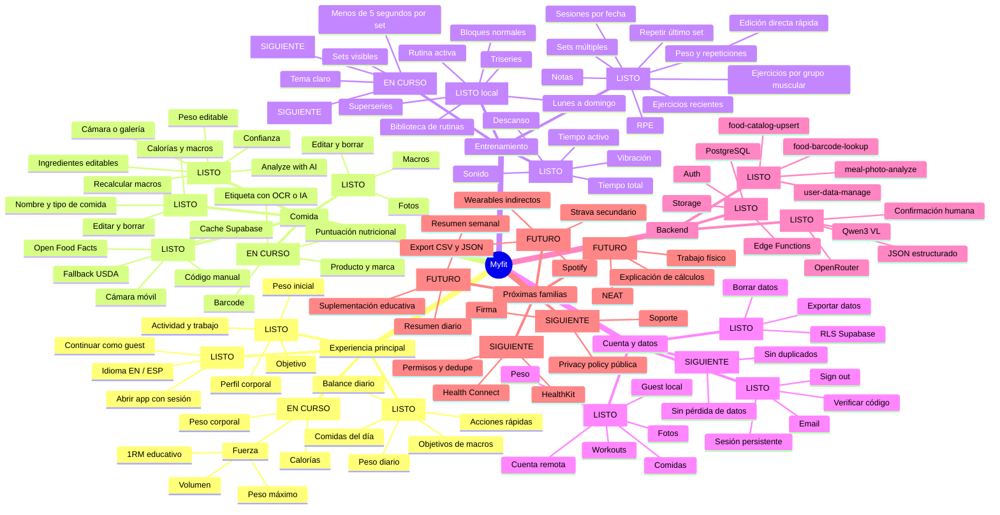

# Árbol De Funciones De Myfit

Leyenda: `[LISTO]` disponible ahora, `[EN CURSO]` necesita consolidación, `[SIGUIENTE]` próximo bloque, `[FUTURO]` backlog.

La rama principal para usar todos los días es: `Dashboard -> Workout manual -> sets con kg/reps -> guardar sesión -> Progreso`.
